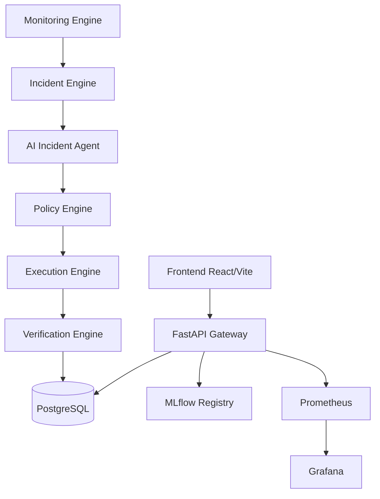

# AegisML — Autonomous Self-Healing MLOps Platform

AegisML is a production-inspired autonomous MLOps control plane that continuously monitors an ML system, detects failures, investigates root causes using an AI agent, and remediates problems automatically — or requests human approval for high-risk actions.

```
DETECT → DIAGNOSE → PLAN → POLICY CHECK → REMEDIATE → VERIFY → LEARN
```

---

## Problem Statement

Traditional MLOps systems require human intervention for every incident: drift detected → Slack alert → engineer triages → engineer fixes. This introduces MTTR measured in hours or days, requires on-call engineers, and doesn't scale.

AegisML replaces reactive human triage with an autonomous control loop while preserving human oversight for high-risk decisions.

---

## Architecture



### Component Responsibilities

| Component | Role |
|---|---|
| **Monitoring Engine** | Drift detection (Evidently + KS/TVD), performance degradation, latency |
| **Incident Engine** | Creates, persists, and transitions incident state |
| **AI Incident Agent** | Evidence-gathering + diagnosis (LLM with rule-based fallback) |
| **Policy Engine** | Deterministic approval/denial — LLM cannot bypass this |
| **Execution Engine** | Only component that executes actions (allowlisted only) |
| **Canary Router** | Real weighted traffic splitting between production and candidate |
| **Self-Healing Orchestrator** | Ties all components together into the autonomous lifecycle |

---

## Incident Lifecycle

```
DETECTED → INVESTIGATING → DIAGNOSED → [AWAITING_APPROVAL] → REMEDIATING → VERIFYING → RESOLVED
                                                                                    ↘ ROLLED_BACK
```

Every state transition creates an **immutable timeline event** and an **audit log entry**.

---

## Agent Architecture

The AI agent is **advisory only**. It proposes; the Policy Engine decides.

```
Incident Created
      ↓
Agent collects evidence via controlled tools:
  get_incident(), get_model_metrics(), get_drift_report(),
  get_data_quality_report(), get_recent_pipeline_runs(),
  get_model_versions(), get_deployment_status(),
  get_previous_incidents(), get_system_health(), get_runbook()
      ↓
Agent produces structured diagnosis:
  { diagnosis, root_cause, confidence, evidence[],
    recommended_action, risk_level, requires_human_approval,
    verification_plan[] }
      ↓
Policy Engine evaluates → APPROVED / DENIED / REQUIRES_APPROVAL
      ↓
Execution Engine acts (if APPROVED)
```

The agent **never** executes arbitrary shell commands. All tool calls are read-only. All actions go through the policy engine.

### LLM Failure Handling

If the LLM is unavailable, times out, or returns invalid JSON, the system automatically falls back to **rule-based diagnosis** covering all incident types. The platform never fails silently.

---

## Policy Engine

Policies are **deterministic Python** — not LLM prompts.

| Policy | Trigger | Decision |
|---|---|---|
| A — Auto Retrain | drift > threshold OR f1 < threshold AND data quality PASSED | APPROVED |
| B — Canary | quality gates PASSED AND latency ≤ SLA | APPROVED |
| C — Require Approval | risk = HIGH/CRITICAL OR large metric jump | REQUIRES_APPROVAL |
| D — Reject | quality gates FAILED | DENIED |
| E — Auto Rollback | canary error rate > threshold OR latency > SLA | APPROVED |

---

## Self-Healing Workflow (Demo Scenario 1 — Success)

1. User opens dashboard, triggers **Data Drift Simulation**
2. Monitoring snapshot created: income drift score 0.34, F1 drops to 0.79
3. Incident `#XXXX` created — status: `DETECTED`
4. User clicks **Run AI Investigation** → agent gathers 12 evidence items
5. Diagnosis: *"Feature drift in income and employment_years. Drift score 0.34 exceeds threshold 0.20. F1 degraded to 0.79."*
6. Recommended action: `RETRAIN_MODEL` — risk: `MEDIUM`
7. User clicks **Execute Remediation** → Policy Engine: `APPROVED`
8. Training pipeline runs (dataset v1 → preprocessing → training → MLflow registration)
9. Quality gates evaluated: F1 0.91 ≥ 0.89+0.02 ✓, latency 18ms ≤ 200ms ✓
10. Canary deployment starts at 10% traffic
11. Health check passes → traffic advances: 10% → 25% → 40% → 55% → 70% → 85% → 100%
12. Model promoted to production — incident status: `RESOLVED`
13. Audit log records every action. Dashboard shows updated MTTR.

## Self-Healing Workflow (Demo Scenario 2 — Rollback)

1. Trigger **Deployment Failure Simulation** (bad canary: error_rate=18%, latency=450ms)
2. Canary health check evaluates gates:
   - error_rate 0.18 > threshold 0.05 ❌
   - latency 450ms > SLA 200ms ❌
3. Policy E: automatic rollback APPROVED
4. Execution Engine restores previous production model
5. Incident status: `ROLLED_BACK`
6. Dashboard shows rollback reason and failed gates

---

## Model Lifecycle

```
CANDIDATE → VALIDATED → CANARY → PRODUCTION
                ↘              ↘
              REJECTED      ROLLED_BACK
```

---

## Tech Stack

| Layer | Technology |
|---|---|
| Backend | Python 3.11, FastAPI, Pydantic v2, SQLAlchemy 2, Alembic |
| Database | PostgreSQL (production), SQLite (tests) |
| ML | scikit-learn, pandas, numpy, scipy |
| Experiment Tracking | MLflow |
| Data Versioning | DVC |
| Drift Detection | Evidently, KS test, Total Variation Distance |
| AI Agent | LangChain + OpenAI (rule-based fallback) |
| Observability | Prometheus, Grafana, structlog |
| Frontend | React 18, Vite, TypeScript, Tailwind CSS, Recharts |
| CI/CD | GitHub Actions |
| Containers | Docker, Docker Compose |

---

## Setup

### Prerequisites

- Docker Desktop
- Python 3.11+
- Node.js 20+

### 1. Clone and configure

```bash
git clone <repo>
cd aegisml
cp .env.example .env
# Edit .env — set OPENAI_API_KEY if you want LLM diagnosis
# Leave it empty for rule-based fallback (fully functional)
```

### 2. Start all services

```bash
docker compose up --build
```

This starts: PostgreSQL, MLflow, AegisML backend, frontend, Prometheus, Grafana.

### 3. Bootstrap (first run only)

```bash
python scripts/setup.py
```

Generates datasets, runs the initial training pipeline, verifies the backend.

### 4. Access

| Service | URL |
|---|---|
| **AegisML Dashboard** | http://localhost:5173 |
| **API Documentation** | http://localhost:8000/api/docs |
| **MLflow** | http://localhost:5001 |
| **Grafana** | http://localhost:3001 (admin/admin) |
| **Prometheus** | http://localhost:9090 |

---

## Running Locally (without Docker)

```bash
# 1. Start PostgreSQL and MLflow separately, or use Docker for just those:
docker compose up postgres mlflow -d

# 2. Install backend
pip install -e "backend/.[dev]"

# 3. Generate data and train
python ml/data/generate_dataset.py --version v1
cd backend && python ../ml/training/train.py --dataset-version v1

# 4. Start backend
cd backend
uvicorn aegisml.main:app --reload --port 8000

# 5. Start frontend (separate terminal)
cd frontend
npm install
npm run dev
```

---

## Running Simulations

From the **Simulations** page in the UI, or via API:

```bash
# Data Drift
curl -X POST http://localhost:8000/api/incidents/simulate \
  -H "Content-Type: application/json" \
  -d '{"simulation_type": "DATA_DRIFT", "parameters": {"income_multiplier": 1.5}}'

# Deployment Failure (triggers automatic rollback)
curl -X POST http://localhost:8000/api/incidents/simulate \
  -H "Content-Type: application/json" \
  -d '{"simulation_type": "DEPLOYMENT_FAILURE", "parameters": {"error_rate": 0.18}}'
```

All simulations are labeled `[SIMULATION]` and trigger the real AegisML workflow.

---

## Testing

```bash
# Set environment
export PYTHONPATH="backend:ml"
export DATABASE_URL="sqlite:///./test_aegisml.db"
export AEGISML_ENVIRONMENT="development"
export LLM_FALLBACK_MODE="rule_based"

# Run all tests
python -m pytest tests/ -v

# Run specific suites
python -m pytest tests/test_policy_engine.py -v       # Policy rules
python -m pytest tests/test_self_healing_workflow.py -v  # End-to-end lifecycle
python -m pytest tests/test_data_validation.py -v    # Data quality + drift
```

**Current status: 57 tests, 57 passing.**

---

## Key Platform Metrics

| Metric | Description |
|---|---|
| **MTTD** | Mean Time To Detect (monitoring interval) |
| **MTTR** | Mean Time To Resolve (incident creation → resolution) |
| **Auto-Remediation Rate** | % incidents resolved without human approval |
| **Remediation Success Rate** | % attempted remediations that succeeded |
| **Rollback Rate** | % canary deployments that required rollback |
| **Model Promotion Rate** | % candidate models passing quality gates |

---

## Security

- API key authentication (`X-API-Key` header)
- All secrets via environment variables — none in code
- LLM **cannot** execute arbitrary shell commands
- All actions go through deterministic policy engine
- Execution engine uses an explicit allowlist of actions
- CORS configured for known origins
- Audit log is append-only from the UI

---

## Configuration (`.env`)

All thresholds are configurable — never hardcoded:

```env
DRIFT_THRESHOLD=0.20           # KS/TVD drift score trigger
F1_THRESHOLD=0.82              # F1 below this triggers incident
LATENCY_SLA_MS=200             # Latency SLA for canary health checks
ERROR_RATE_THRESHOLD=0.05      # Error rate rollback trigger
CONSECUTIVE_WINDOWS_FOR_INCIDENT=3
CANARY_INITIAL_TRAFFIC=0.10
CANARY_STEP_SIZE=0.15
```

---

## Project Structure

```
aegisml/
├── backend/aegisml/
│   ├── api/routes/          # FastAPI route handlers
│   ├── agents/              # AI incident agent + tools
│   ├── database/            # SQLAlchemy models + session
│   ├── deployments/         # Canary router + health monitor
│   ├── execution/           # Execution engine (allowlisted actions)
│   ├── incidents/           # Incident service
│   ├── monitoring/          # Simulation engine
│   ├── orchestrator/        # Self-healing orchestrator
│   ├── policies/            # Deterministic policy engine
│   └── main.py              # FastAPI app entry point
├── ml/
│   ├── data/                # Dataset generator
│   ├── preprocessing/       # Feature pipeline
│   ├── training/            # Training script
│   ├── evaluation/          # Quality gate evaluator
│   ├── validation/          # Data validator
│   └── monitoring/          # Drift + performance monitors
├── frontend/src/
│   ├── pages/               # 9 pages: Dashboard, Incidents, etc.
│   ├── components/          # Shared components
│   └── services/api.ts      # Typed API client
├── tests/                   # 57 tests
├── runbooks/                # 4 JSON runbooks
├── monitoring/              # Prometheus + Grafana configs
├── .github/workflows/       # CI/CD pipeline
├── docker-compose.yml
├── dvc.yaml
└── .env.example
```

---

## Future Improvements

- Multi-model support (currently one primary model per deployment)
- Streaming WebSocket updates for real-time incident timeline
- Alembic migrations for schema evolution
- Kubernetes deployment manifests
- RAG-powered historical incident search (currently keyword-based)
- A/B testing framework alongside canary
- Cost tracking per model version
- Slack/PagerDuty notification webhooks
